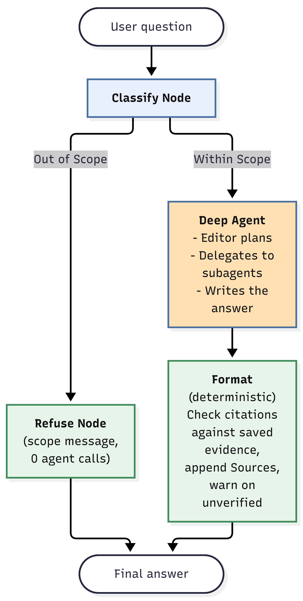
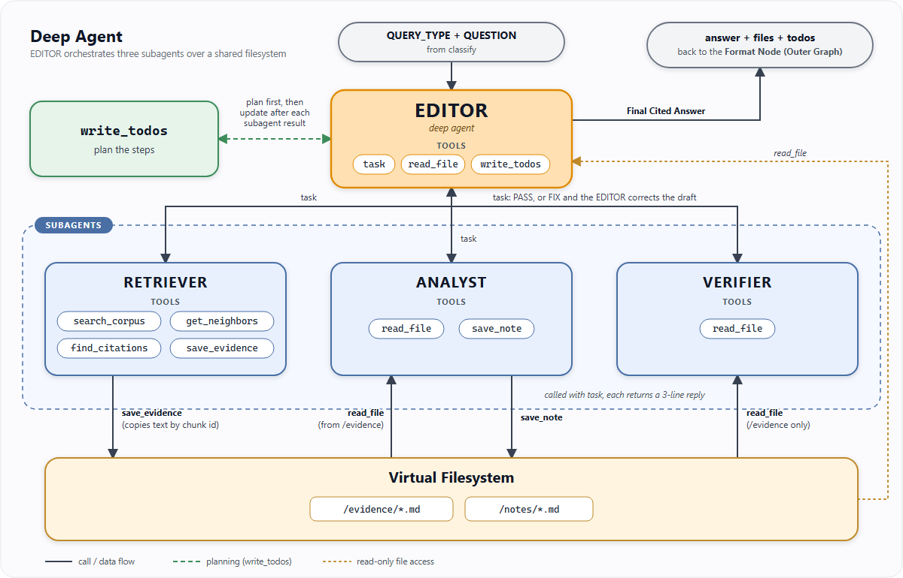

# Multi-Agent RAG — LangChain + LangGraph + DeepAgents

A question-answering system for dense legal documents, where a plausible-sounding answer is not good enough: every claim has to be traceable to the exact passage that supports it.

Legal text is hard for a plain retrieve-and-generate pipeline. Answers hinge on precise wording, rule numbers and who argued what, and many questions need information from more than one document (comparing two arguments, or applying a rule from one source to the facts of another). A single prompt over a handful of retrieved chunks tends to paraphrase, blend sources together, or confidently answer questions the documents never address.

This project handles that with a small team of cooperating agents instead of one prompt:

- **Understand the question first.** It is classified up front, so off-topic or unanswerable questions are refused cheaply and each remaining type gets the right amount of work.
- **Retrieve, then reason, as separate steps.** A retriever finds and saves the relevant passages verbatim, an analyst turns them into structured notes, and an editor writes the answer only from that saved material.
- **Check before answering.** For multi-part questions a verifier re-reads the draft against the saved evidence, and the final answer's citations are matched back to real passages, with any that can't be verified flagged.

The result is answers that stay grounded in the source text, show where each claim came from, and say so when the documents don't contain the answer.

## LangGraph flow

<p align="center">
  
</p>

- **Classify Node**: routes by query type; falls back to `unknown` if every provider fails.
- **Deep Agent Node**: runs the DeepAgents Editor below.
- **Format Node**: deterministic. Matches each `[label, p.N]` / `[label ¶N]` in the answer to a saved evidence heading, appends a Sources block and warns about unverified citations.

## DeepAgents flow



The Editor routes by query type:

| Query type | Subagent sequence |
|---|---|
| lookup, concept | retriever → answer |
| compare | retriever per side → analyst per side → answer → **verifier** |
| connect | retriever A → analyst → retriever B (queried with A's rule) → analyst → answer → **verifier** |

Subagents share a virtual filesystem: the retriever writes `/evidence`, the analyst writes `/notes`, the verifier reads only `/evidence`. The Editor sees each subagent's short 3-line reply, not its full context. A draft that comes back with `FIX` is corrected before the answer is returned.

## Agent roles

| Agent | Where | Job |
|---|---|---|
| **Classifier** | LangGraph node | One small-model call tags the question (`lookup`, `concept`, `compare`, `connect`, `timeline`, `unanswerable`, `out_of_scope`). Off-topic questions are refused with zero agent calls. |
| **Editor** | DeepAgents main agent | Plans with a to-do list, delegates through `task`, reads the saved files and writes the final cited answer. It has no search tool of its own. |
| **Retriever** | Subagent | Takes one sub-question, runs hybrid search, and saves the chosen passages verbatim to `/evidence/<id>.md`. Returns a 3-line verdict (`FOUND`, `PARTIAL` or `NONE`). |
| **Analyst** | Subagent | Reads one evidence file and writes a structured note (holding, argument or timeline) to `/notes/<id>.md`. |
| **Verifier** | Subagent | Checks the Editor's draft against `/evidence` only: quotes, numbers, dates, citations, attribution. Returns `PASS` or a fix list. |

## Approach Followed

- **Ingest**: PDFs are cleaned of headers, footers and page numbers, then split into sections by heading detection. The table of contents and tables of authorities are kept but flagged non-searchable. A citation index (`find_citations`) is built alongside.
- **Roles on different models**: the Editor uses Groq `gpt-oss-120b`, the analyst `qwen3.8-27b`, and the retriever, verifier and classifier `gpt-oss-20b`. Groq quotas are per model, so this spreads the load.

### Chunking
- **Section and paragraph aware**, about 400 tokens with a 480 hard cap (sized to the 512-token limit of the **bge-small embedder**, counted with its tokenizer).
- Chunks never cross a heading. **Paragraphs stay whole** and are **split at sentence boundaries** only when over the cap. Legal abbreviations (`U.S.`, `Cir.`, `v.`) do not count as sentence ends.
- About 50 tokens of whole-sentence overlap inside a section. The SEC complaint is grouped by numbered paragraph (`¶45`) with no overlap.
- **Each chunk embeds a one-line header** (document · type · section path) and keeps `prev_id` / `next_id`, page or paragraph range, and rule references (`10b-5(b)`, `Item 303`). This helps in keyword matching during the Hybrid Search as paragraph text may not be topic aware.  

### Retrieval
- **Hybrid**: `BAAI/bge-small-en-v1.5` dense vectors (Chroma, cosine) plus BM25, fused with reciprocal-rank fusion. Exact strings such as `Item 303` match lexically.
- **Filters on `doc_id` and section** are applied before ranking, so a filtered search still returns the best k.
- Tools: `search_corpus`, `get_neighbors` (read a hit in context), `find_citations`, `save_evidence` (copies text by chunk id, so quotes cannot be paraphrased on the way in).
- Answerability is judged from passage content(`Editor` does this), not a score because an unanswerable question still scored 0.75 cosine.

### Rate limiting
Token budget is the binding limit (Groq free tier: 8K tokens per minute per model), not request count.
- **Token bucket per Groq model** (`src/token_budget.py`): reserves prompt estimate plus expected completion, settles with real usage, waits for refill, and fails over rather than earning a 429.
- **Request limiter** per provider (`InMemoryRateLimiter`).
- **Retry** with exponential backoff on 429, 5xx and timeouts. Daily-quota errors skip retry and fall back immediately.
- **Fallback chain**: second Groq model → OpenRouter → Gemini. A provider whose key is unset is skipped.
- **Token-lean agents**: the Editor and subagents keep only the tools they need, and retriever hits are returned as 450-character previews.
- **Hard caps**: Editor recursion limit 40, `max_concurrency=1`, and a SQLite LLM cache (`.langchain.db`).

## Running

```bash
python -m venv .venv && source .venv/bin/activate    # Windows: .venv\Scripts\activate
pip install -r requirements.txt
cp .env.example .env                                 # set at least one of GROQ_API_KEY / OPENROUTER_API_KEY / GOOGLE_API_KEY

python main.py "How far did Macquarie's stock price fall?"
python main.py --demo                                # lookup, unanswerable, out of scope paths
```

The first run ingests the PDFs in `data/` and builds the index in `index/`; `--rebuild-index` forces a rebuild. `--trace` prints the query type, subagents used and LLM call counts; setting `LANGSMITH_API_KEY` traces the Editor and its subagents in LangSmith.

Tests that need no API key: `pytest tests/test_*.py`.

### Docker

The image bakes in the `BAAI/bge-small-en-v1.5` embedder and the built Chroma + BM25 index, so a container starts answering without downloading or indexing anything. It is `linux/amd64` (CPU-only torch, about 2 GB); on an ARM host add `--platform linux/amd64`.

```bash
docker build -t virallens-rag .

docker run --rm --env-file .env virallens-rag --demo
docker run --rm --env-file .env virallens-rag "How far did Macquarie's stock price fall?" --trace

docker run --rm --entrypoint pytest virallens-rag tests -q    # no API keys needed
```

API keys are never baked into the image. `--env-file` needs plain `KEY=value` lines; if your `.env` has spaces around `=`, mount it instead: `-v "$(pwd)/.env:/app/.env:ro"`.

## Q2: custom embedder

A domain-adapted `bge-small-en-v1.5` for the five filings, compared against the stock model on retrieval, clustering and similarity checks. Code, 6 figures and the write-up (findings, challenges, model behaviour, references) are in [q2_embedder_final/](q2_embedder_final/); start with [CustomEmbedder.md](q2_embedder_final/CustomEmbedder.md). Entry point: `python -m q2_embedder_final.main_qa` (see its Reproduce section; weights are not committed).

## Note on rate limits

Multi-hop queries (compare and connect) make many sequential LLM calls across several subagents, so on free-tier quotas they can occasionally fail or return degraded answers because of rate limits. For best results, set all three provider keys (`GROQ_API_KEY`, `OPENROUTER_API_KEY`, `GOOGLE_API_KEY`) so the fallback chain has somewhere to go when one provider is throttled.
