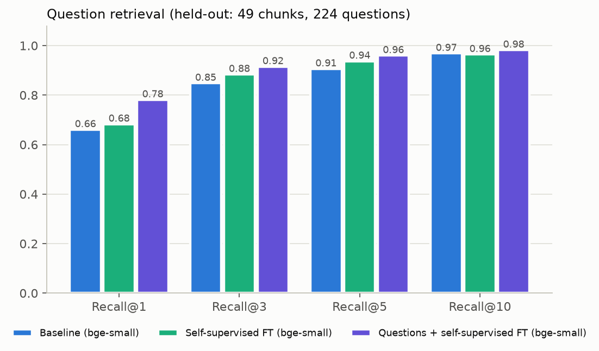
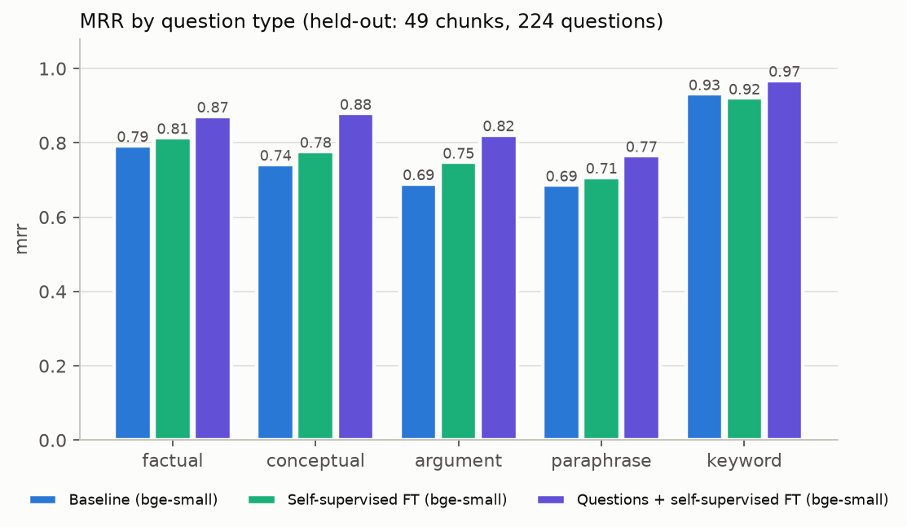
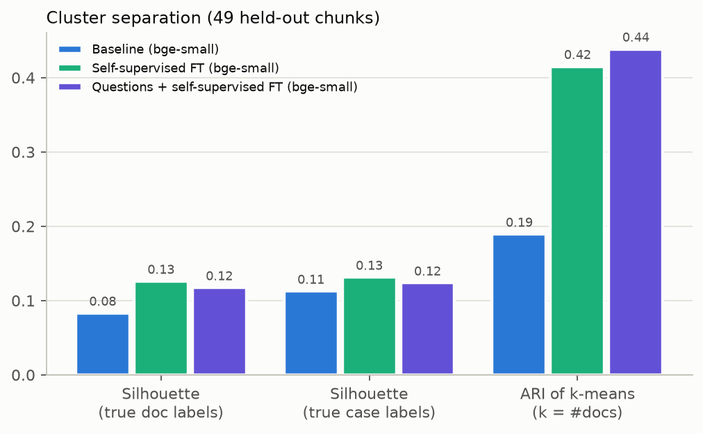
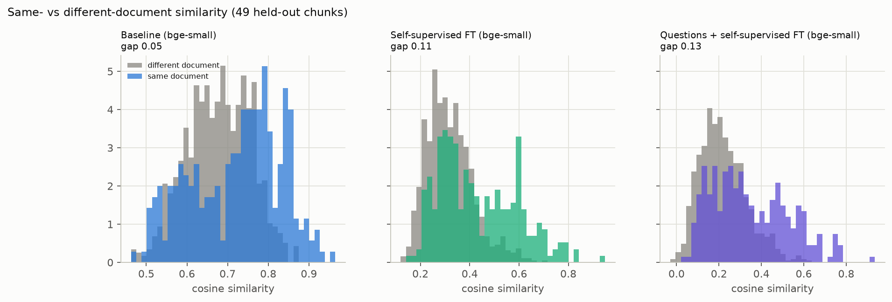
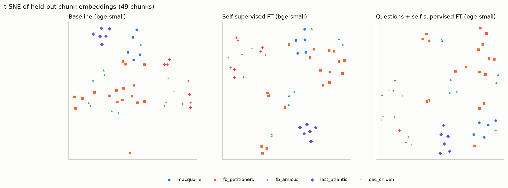
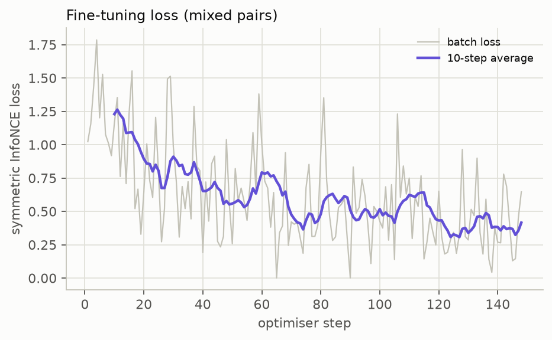

# Q2 – Custom embedder for securities-law documents

A domain-adapted version of `BAAI/bge-small-en-v1.5` (384-d) for the five court filings in `data/`. It is fine-tuned on two kinds of pairs: **self-supervised sentence-split pairs** and **synthetic question → chunk pairs**. Everything below is read off the final run, `outputs3/heldout/`, which is the only run reported in the results sections.

| | |
|---|---|
| Corpus | 196 body chunks from 5 PDFs (4 cases; the two Facebook briefs are one case). Chunks come from the Q1 ingest and the document header is excluded so the file name cannot leak into the embedding. |
| Split | Contiguous blocks of 6 chunks per document are held out: **147 train / 49 test chunks**. Neighbouring chunks overlap by about 50 tokens, so a random split would leak text. |
| Training pairs | **580** self-supervised pairs + **573** question→chunk pairs, from the 147 train chunks only. |
| Test questions | **224** questions written from the 49 held-out chunks. Neither the chunks nor the questions were seen in training. |
| Compared | (1) Baseline `bge-small`, (2) self-supervised fine-tune only, (3) **self-supervised + question pairs (final)**. |

## Deliverables map

| Task item | Where |
|---|---|
| Preprocessing | [preprocess.py](preprocess.py) (load chunks, labels, block split, self-supervised pairs), [build_training_data.py](build_training_data.py) (question validation and filtering) |
| Training | [train.py](train.py) (contrastive fine-tune, plain torch loop) |
| Embedding | [embed.py](embed.py) |
| Clustering | [cluster.py](cluster.py) (k-means, agglomerative, k sweep, t-SNE) |
| Evaluation | [evaluate.py](evaluate.py) (clustering and similarity), [retrieval_eval.py](retrieval_eval.py) (retrieval, bootstrap) |
| Plots | [visualize.py](visualize.py), figures in [outputs3/heldout/](outputs3/heldout/) |
| Sample main file | [main_qa.py](main_qa.py) |
| Raw dump of resources | [resources/README.md](resources/README.md) and [References](#references) below. Training data is in [training_data/](training_data/) (authored questions in `raw/`, filtered `train.jsonl` / `test.jsonl`, every dropped question in `dropped.jsonl`). |

---

## 1. Findings

### 1.1 Base models analysed

| | `all-MiniLM-L6-v2` | `BAAI/bge-small-en-v1.5` |
|---|---|---|
| Size | 6 layers, 384-d, about 22M params | 12 layers, 384-d, about 33M params |
| Max input | 256 tokens by default (trained on 128) | 512 tokens |
| Starting point | `MiniLM-L6-H384` — a small student distilled from a larger transformer by self-attention distillation | BERT-style encoder pre-trained with **RetroMAE**, a masked-autoencoder objective aimed at dense retrieval |
| Training | Contrastive fine-tuning on **over 1 billion** sentence pairs from many sources (Reddit, S2ORC, WikiAnswers, PAQ, Stack Exchange, MS MARCO and others). Loss is in-batch-negatives InfoNCE. | Large-scale contrastive pre-training on text pairs, then fine-tuning on labelled query–passage data with **hard negatives** and an **instruction** on the query side. v1.5 also reduces the "all cosines are 0.6–1.0" problem. |
| Speciality | General-purpose **symmetric** sentence similarity, clustering, short-text semantic search | **Asymmetric retrieval**: a short query finds a long passage. Strong on MTEB retrieval. Queries are prefixed with `Represent this sentence for searching relevant passages:`. |
| Fit for this task | Trained on short inputs, so 400-token legal chunks are out of its comfort zone | Built for query→passage retrieval, and is the retriever already used in the Q1 RAG system |

A third, non-neural model was tried early on: **TF-IDF + LSA** (64-d) with a legal-aware tokenizer that drops reporter citations and "see / id / supra" boilerplate. It is lexical and cannot embed free-text queries semantically, so it was dropped.

### 1.2 Iterations

| Run | Change | Held-out (49 chunks) result |
|---|---|---|
| **v1**, superseded experiment (not in this repo) | Baseline `all-MiniLM-L6-v2`; fine-tune on self-supervised pairs; LSA as a lexical alternative | Fine-tune gain was small. Doc silhouette 0.080 → 0.094, pair AUC 0.631 → 0.648, k-means ARI 0.203 → 0.344, and **kNN purity@5 fell 0.657 → 0.633**. LSA scored higher on silhouette (0.200) but is not usable as a query embedder. |
| **v2**, superseded experiment (not in this repo) | **Switched to `bge-small-en-v1.5`**; same self-supervised pairs | Larger and cleaner gain. Doc silhouette 0.083 → 0.126, pair AUC 0.641 → 0.714, k-means ARI 0.189 → 0.415, similarity gap 0.046 → 0.114. kNN purity@5 unchanged (0.678 → 0.682). |
| **v3**, `q2_embedder_final/outputs3` (**final**) | **Added 573 synthetic question→chunk pairs** to the self-supervised pairs | Retrieval improves clearly on top of v2 (R@1 0.683 → 0.781, MRR 0.792 → 0.860). Clustering is about the same as v2 (ARI 0.415 → 0.439, silhouette 0.126 → 0.117). |

**Why the switch from MiniLM to bge-small**

1. **Sequence length.** Chunks are about 400 tokens. MiniLM was trained on 128-token inputs with a 256-token default cap, so it has to be run past its training length (we forced 384) or it truncates. bge-small supports 512 natively.
2. **It is the RAG retriever.** Q1 retrieves with bge-small. A domain adaptation of a different model could not be dropped into that pipeline without re-validating everything.
3. **Retrieval-trained.** bge-small is built for query→passage matching, which is what a RAG system does. The MiniLM fine-tune also gave little on held-out data (see v1 above), so there was little reason to stay.

**Why add question pairs (v2 → v3).** The self-supervised pairs (two halves of one chunk) only teach "sentences from the same passage belong together". That sharpens document structure but never exposes the model to what a RAG system actually does: map a *user question* to the *passage that answers it*. v2 gave better clusters but only a small retrieval gain (the bootstrap interval on MRR and Recall@1 includes 0, §2.3). Adding question→chunk pairs trains that query→passage mapping directly.

### 1.3 Final training recipe (v3)

- **Pairs:** 580 self-supervised pairs (4 rounds of two disjoint random halves of each chunk's sentences) plus 573 question→chunk pairs. Questions carry the bge query prefix; chunks do not.
- **Loss:** symmetric InfoNCE with in-batch negatives (`scale = 20`). Each batch is built from one round only, and a round holds at most one pair per chunk, so a chunk is never its own in-batch negative.
- **Optimiser:** AdamW, lr 2e-5, weight decay 0.01, 10% warm-up then linear decay, gradient clip 1.0, batch 16, 2 epochs, seed 42.
- **Cost:** 148 steps, 1,542 s on CPU. Mean batch loss falls from **1.23** (first 10 steps) to **0.42** (last 10 steps).
- **Checkpoint:** `outputs3/heldout/finetuned_model/`, trained on the 147 train chunks only so the held-out numbers stay honest.

---

## 2. Results (v3, 49 held-out chunks, 224 held-out questions)

### 2.1 Retrieval metrics (what matters for RAG)

Each held-out question is embedded (with the bge query prefix) and ranked against the chunk pool. The **gold chunk** is the chunk the question was written from. Recall@k asks whether the gold chunk is among the k passages handed to the LLM, so Recall@3 / Recall@5 are the numbers to read for a RAG system that passes 3–5 chunks of context.

**Pool = the 49 held-out chunks (headline)**

| model | R@1 | R@3 | R@5 | R@10 | MRR | median rank |
|---|---|---|---|---|---|---|
| Baseline bge-small | 0.661 | 0.848 | 0.906 | 0.969 | 0.768 | 1 |
| Self-supervised FT | 0.683 | 0.884 | 0.938 | 0.964 | 0.792 | 1 |
| **Questions + self-supervised FT (final)** | **0.781** | **0.915** | **0.960** | **0.982** | **0.860** | 1 |

**Pool = all 196 chunks (harder, 4× more distractors; the fine-tuned models saw the 147 train chunks as text)**

| model | R@1 | R@3 | R@5 | R@10 | MRR |
|---|---|---|---|---|---|
| Baseline bge-small | 0.536 | 0.705 | 0.768 | 0.862 | 0.646 |
| Self-supervised FT | 0.558 | 0.737 | 0.808 | 0.906 | 0.669 |
| **Questions + self-supervised FT (final)** | **0.612** | **0.830** | **0.879** | **0.938** | **0.734** |

Per-question rank change versus the baseline (final model): in the 49-chunk pool, **25.0%** of questions move the gold chunk up, 70.5% are unchanged and **4.5%** move it down. In the 196-chunk pool the split is 34.8% / 56.7% / 8.5%, and the mean gold rank improves from 6.27 to 3.88.



**By question type (MRR / Recall@1)**

| model | factual | conceptual | argument | paraphrase | keyword |
|---|---|---|---|---|---|
| Baseline | 0.792 / 0.675 | 0.742 / 0.628 | 0.690 / 0.578 | 0.686 / 0.531 | 0.932 / 0.894 |
| Self-supervised FT | 0.814 / 0.725 | 0.777 / 0.651 | 0.748 / 0.622 | 0.707 / 0.551 | 0.920 / 0.872 |
| **Final** | **0.872 / 0.800** | **0.879 / 0.814** | **0.821 / 0.711** | **0.765 / 0.653** | **0.968 / 0.936** |



**By source document (49-chunk pool, MRR / Recall@1)**

| document | n questions | Baseline | Self-supervised FT | **Final** |
|---|---|---|---|---|
| macquarie | 24 | 0.685 / 0.542 | 0.794 / 0.708 | **0.868 / 0.792** |
| fb_petitioners | 80 | 0.729 / 0.625 | 0.742 / 0.625 | **0.792 / 0.688** |
| fb_amicus | 35 | 0.796 / 0.686 | 0.798 / 0.686 | **0.907 / 0.857** |
| last_atlantis | 27 | 0.756 / 0.593 | 0.806 / 0.667 | **0.889 / 0.815** |
| sec_chiueh | 58 | 0.845 / 0.776 | 0.852 / 0.759 | **0.908 / 0.845** |

### 2.2 Clustering and similarity metrics

The 49 held-out chunks are clustered with k-means (k = 5 documents). Labels are the source document and case; they are used for evaluation only, never for training.

| model | sil (doc) | sil (case) | sim gap (intra − inter) | pair AUC | k-means ARI | NMI | agglo. ARI | kNN purity@1 / @5 |
|---|---|---|---|---|---|---|---|---|
| Baseline bge-small | 0.083 | 0.113 | 0.046 | 0.641 | 0.189 | 0.406 | −0.016 | 0.878 / 0.678 |
| Self-supervised FT | **0.126** | **0.131** | 0.114 | **0.714** | 0.415 | 0.574 | **0.307** | 0.857 / 0.682 |
| **Questions + self-supervised FT** | 0.117 | 0.124 | **0.128** | 0.707 | **0.439** | **0.585** | 0.280 | **0.939** / 0.682 |









### 2.3 Is the improvement real? Paired chunk-bootstrap (95% interval)

Questions from one chunk are correlated, so the bootstrap resamples **chunks**, not questions.

| comparison (49-chunk pool) | metric | mean diff | 95% interval | excludes 0 |
|---|---|---|---|---|
| Final − Baseline | MRR | +0.092 | [+0.063, +0.124] | yes |
| Final − Baseline | Recall@1 | +0.121 | [+0.075, +0.172] | yes |
| Final − Baseline | Recall@5 | +0.054 | [+0.027, +0.086] | yes |
| Final − Self-supervised | MRR | +0.067 | [+0.044, +0.093] | yes |
| Final − Self-supervised | Recall@1 | +0.098 | [+0.058, +0.141] | yes |
| Self-supervised − Baseline | MRR | +0.024 | [−0.001, +0.051] | **no** |
| Self-supervised − Baseline | Recall@1 | +0.022 | [−0.018, +0.063] | **no** |

The gain from adding question pairs is statistically clear on the held-out pool and also on the 196-chunk pool (MRR +0.089 vs baseline, interval [+0.056, +0.122]). The gain from self-supervised pairs alone on retrieval is **not**.

---

## 3. Challenges

### 3.1 Quality and variety of the training pairs (the main one)

The corpus has only 196 chunks, there is no labelled question set, and a pair that is wrong or too easy teaches the wrong thing. Making question pairs that are both *correct* and *varied* took most of the effort.

- **Variety.** One question style would teach the model one query style. Each chunk got **five questions, one per type**: factual (a specific fact, date or number), conceptual (a doctrine or rule), argument (a party's position or reasoning), paraphrase (no overlap in wording with the chunk) and keyword (a short search-style query of 3–6 words). Question types are tracked end to end, which is what makes the by-type breakdown in §2.1 possible.
- **Lexical shortcuts.** If a question copies a phrase from its chunk, the model learns string overlap, not meaning. Any question that contained an 8-token span copied from its chunk was dropped (**89 of 980**).
- **Questions that only make sense with the chunk in hand** ("according to this passage", "on page 5") were removed with a pattern filter (2 dropped). Naming a kind of filing ("the brief", "the complaint") is allowed because that is how a real user would ask.
- **Near-duplicate siblings.** Two questions from the same chunk with cosine above 0.95 add nothing, so the later one was dropped.
- **Round-trip filter (train only).** A question was kept only if the baseline retrieved its source chunk in the top 10 of all 196. This removed 92 train questions that the baseline could not map back to their own chunk, which keeps the training signal to questions that are actually answerable from that chunk. Test questions were deliberately **not** filtered this way, so the test set is not biased toward questions the baseline already answers.
- **No LLM API was used.** All 980 questions were written by Claude (the coding assistant) reading each chunk. This kept the pairs free of provider noise but sets a limit on realism (see §5).
- **Yield.** Of 735 authored train questions, 573 survive (about 3.9 per chunk; 13 chunks have fewer than 3; 1 chunk has none). The 49-chunk test set kept 224 of 245.

| type | train kept / authored | test kept / authored |
|---|---|---|
| factual | 118 / 147 | 40 / 49 |
| conceptual | 114 / 147 | 43 / 49 |
| argument | 102 / 147 | 45 / 49 |
| paraphrase | 102 / 147 | 49 / 49 |
| keyword | 137 / 147 | 47 / 49 |

### 3.2 Other challenges

- **Tiny corpus.** 196 chunks cannot train an encoder from scratch, so the approach is *adapting* a pre-trained one. All numbers are from a single seed on 49 held-out chunks.
- **Leakage through overlap.** About 50 tokens overlap between neighbouring chunks, so the split is by contiguous blocks.
- **Contradictory in-batch negatives.** Two pairs from the same chunk in one batch would push the chunk away from itself. Batches are built round by round (at most one pair per chunk).
- **Coarse labels.** "Source document" is a proxy for topic. The petitioners' and amicus briefs argue the same case, so silhouette against document labels is capped well below 1 for any model.
- **Compute.** Training ran on CPU only: about 26 minutes for 148 steps.

---

## 4. Model behaviour

- **Retrieval improves most where the baseline was weakest.** MRR gains are largest on conceptual (+0.137) and argument (+0.131) questions, then factual (+0.080) and paraphrase (+0.079). Keyword queries were already at 0.93 and gain only +0.036. Paraphrase remains the hardest type for every model (0.765 for the final one).
- **The model fixes hard cases without breaking easy ones.** Only 4.5% of questions get a worse gold rank. On the 31 questions where the baseline put the gold chunk outside the top 10 of the full corpus, MRR in the held-out pool rises from 0.165 to **0.387**, and Recall@10 from 0.774 to 0.871.
- **Question pairs are doing the retrieval work.** Self-supervised pairs alone give no significant gain in MRR or Recall@1 (§2.3; only Recall@5 clears zero, +0.031) and slightly hurt keyword queries (0.932 → 0.920). They do give most of the clustering gain. The question pairs add a further, significant retrieval improvement and keep the clustering gain.
- **Clustering is similar to v2, not better.** The final model has a slightly *lower* doc silhouette (0.117 vs 0.126) and pair AUC (0.707 vs 0.714) than the self-supervised model, a slightly higher ARI (0.439 vs 0.415) and a clearly higher kNN purity@1 (0.939 vs 0.857). With 49 chunks these differences are within noise. The honest reading is that question pairs bring retrieval and keep clustering.
- **Similarity scale shifts.** Baseline bge cosines sit in a narrow high band (different-document mean 0.677, same-document 0.723). After fine-tuning, different-document pairs drop to 0.220 and same-document to 0.348 (fig 4). Absolute cosine values are **not comparable** between models, so any similarity threshold in the RAG pipeline (e.g. an answerability cut-off) must be recalibrated. Only ranks, the gap and the AUC compare across models.
- **Facebook briefs still overlap.** In the t-SNE maps (fig 6) `sec_chiueh` and `last_atlantis` form compact groups in the fine-tuned models, but `fb_petitioners` and `fb_amicus` overlap in all three, as expected from two briefs on the same case. The best-k from the k sweep (10 / 9 / 8 for the three models; true k = 5) is nearly flat and should not be over-read.
- **Neighbour checks (`outputs3/heldout/neighbors.md`, searching the 49 held-out chunks)** are qualitative and judged from the citations and snippets only:
  - *"pure omissions versus half-truths under Rule 10b-5(b)"*: all three return the same three Macquarie chunks; the fine-tuned models keep the order but with lower absolute scores.
  - *"SEC enforcement action for fraud by an investment adviser"*: the baseline puts two Facebook petitioners' brief chunks at ranks 2–3; the final model returns Chiueh ¶¶174–177 and ¶¶171–173 (the complaint's claims for relief) and then a Last Atlantis chunk. The self-supervised model returns two Chiueh chunks on the Investment Company Act definitions.
  - *"Item 303 …"*: all three models return Facebook petitioners' chunks about Item 105 risk-factor disclosure. No model surfaces an Item 303-specific passage among the held-out chunks.
- **It is still a general-purpose encoder with adapted geometry.** Same 384-d, same tokenizer and same architecture, so it can replace the Q1 embedder with a re-index. The effect on end-to-end answer quality was **not** measured; only retrieval was.

---

## 5. Limitations

- **Small sample.** 49 chunks, 224 questions, one seed. The bootstrap quantifies chunk-sampling noise, not seed-to-seed training noise.
- **One author for train and test questions.** Both were written by the same assistant, so the question *style* is shared between train and test even though the chunks are unseen. Real user queries may be messier or shorter, and the retrieval gain could be smaller on them. This is the main caveat for the headline numbers.
- **The 196-chunk pool is optimistic for the fine-tuned models**: they saw the 147 train chunks as text. The 49-chunk pool is the clean number; the 196-chunk pool is a harder, but partly contaminated, check.
- **Query prefix.** Models were trained with the bge prefix on queries. Without it the final model loses a little (R@1 0.781 → 0.768, MRR 0.860 → 0.853) but stays ahead of the baseline in every setting, so the prefix should be kept.
- **No full-corpus retrain.** The checkpoint is trained on 147 chunks so the evaluation stays held-out. A production model would be retrained on all 196 chunks plus new questions.

## Reproduce

```bash
pip install -r requirements.txt -r q2_embedder_final/requirements.txt
python -m q2_embedder_final.build_training_data build   # validate + filter authored questions -> training_data/
python -m q2_embedder_final.main_qa                      # fine-tune, embed, evaluate -> outputs3/heldout/
python -m q2_embedder_final.main_qa --reuse              # re-evaluate the saved checkpoint, no retraining
```

Model checkpoints and `.npy` embeddings are gitignored (about 130 MB each), so a fresh clone has the code, training data, metrics and figures but not the weights. `main_qa` compares against the v2 self-supervised checkpoint (`--selfsup-model`, default `outputs2/heldout/finetuned_model`), which is not shipped either; without it the comparison step stops with a clear error. The reported numbers are in `outputs3/heldout/results.md`, `retrieval_results.md` and `neighbors.md`.

## References

- Models: [`sentence-transformers/all-MiniLM-L6-v2`](https://huggingface.co/sentence-transformers/all-MiniLM-L6-v2), [`BAAI/bge-small-en-v1.5`](https://huggingface.co/BAAI/bge-small-en-v1.5)
- Reimers & Gurevych (2019), Sentence-BERT — https://arxiv.org/abs/1908.10084
- Wang et al. (2020), MiniLM: deep self-attention distillation — https://arxiv.org/abs/2002.10957
- Xiao et al. (2023), C-Pack / BGE embeddings — https://arxiv.org/abs/2309.07597
- Xiao et al. (2022), RetroMAE — https://arxiv.org/abs/2205.12035
- Henderson et al. (2017), in-batch negatives ranking loss — https://arxiv.org/abs/1705.00652
- Gao et al. (2021), SimCSE — https://arxiv.org/abs/2104.08821
- Wang et al. (2021), TSDAE — https://arxiv.org/abs/2104.06979
- Rousseeuw (1987), Silhouettes; van der Maaten & Hinton (2008), t-SNE; scikit-learn clustering metrics
